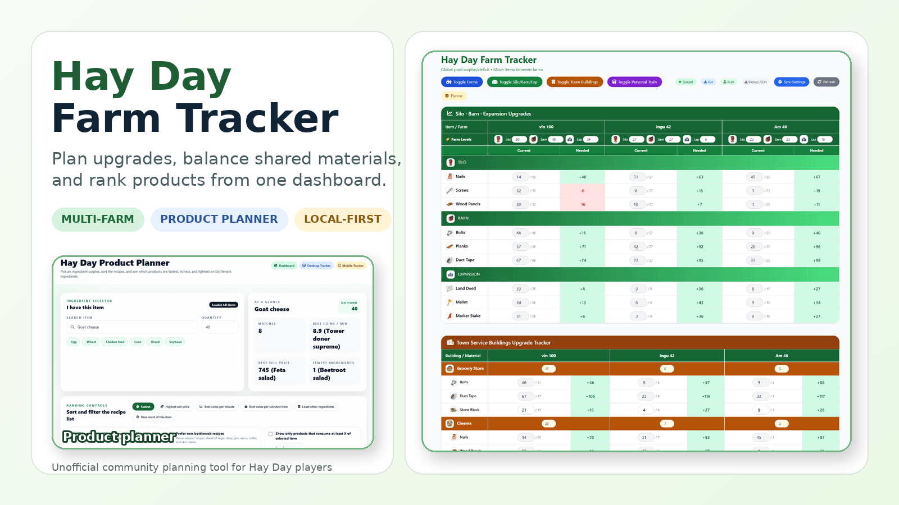
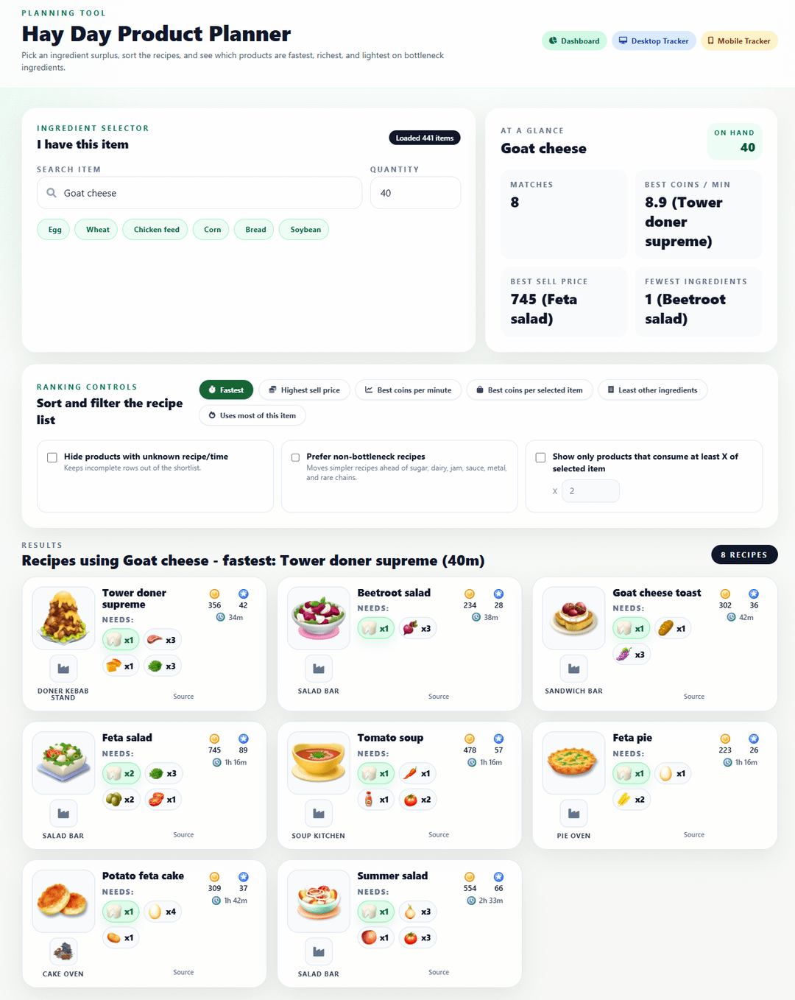
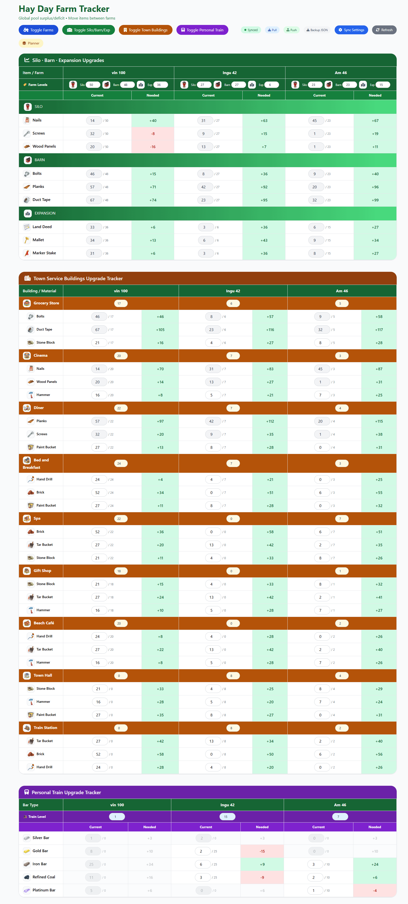

# Hay Day Farm Tracker

A multi-farm planning tool for Hay Day — track upgrade materials, balance surplus between farms, and rank products by speed, sell price, coins per minute, and ingredient bottlenecks.

This unofficial Hay Day farm tracker combines a multi-farm upgrade tracker with a Hay Day product planner. Use it to plan silo and barn upgrades, expansion materials, town building upgrades, recipes, and resource balancing from one place.

It uses a global pool model: the needed amount for each farm is calculated as `totalCurrent(all farms) - farmLevel`. Surplus (`+X`) means you can move items to another farm; deficit (`-X`) means you still need more.

## Screenshots

### Product Planner

Search an ingredient, enter the amount available, and rank matching recipes by speed, sell price, coins per minute, usage of the selected item, or ingredient complexity.

### Multi-farm Upgrade Tracker

Compare multiple farms side by side and immediately see surplus or deficit materials for Silo, Barn, Expansion, Town Service Buildings, and the Personal Train.

## Features

- Multiple farms - add, rename, or delete farms. Data is stored in your browser.
- Global pool logic - see at a glance which farm has extra materials and which needs them.
- All upgrade paths in one place:
  - Silo, Barn, Expansion
  - Town Service Buildings
  - Personal Train
- Desktop and mobile versions share the same data.
- Product lookup - search ingredients to see which recipes use them.
- Cross-device sync - optional GitHub Gist sync.

## Desktop vs. Mobile

| Desktop (`hayday_tracker.html`) | Mobile (`hayday_mobile.html`) |
| --- | --- |
| Wide table, all farms side by side | One farm at a time, dropdown selector |
| Current / Level and Needed columns | Simplified Current and Needed |
| Best for planning moves between farms | Best for quick input on a phone |

## Product Planner

1. Install the importer dependency once with `pnpm install` or `npm install`.
2. Generate live data and local images with `node tools/import_hayday_wiki.js --download-images`.
3. The importer writes `data/hayday_product_data.js`, `data/hayday_import_report.json`, and `images/items/`.
4. Open `hayday_product_planner.html` directly in a browser after the import finishes.
5. Use the `I have this item` search box, quantity field, sort buttons, and filters to rank recipes by speed, value, and ingredient bottlenecks.
6. `--allow-sample` is available only for development fallback, and `--limit <n>` is available for quick debug runs.

## Tech Stack

- HTML5, Tailwind CSS, Font Awesome 6
- Vanilla JavaScript
- localStorage for persistence
- GitHub Gist API for optional sync

## Files

- `hayday_tracker.html` - Desktop version (full table)
- `hayday_mobile.html` - Mobile-friendly version
- `hayday_dashboard.html` - Dashboard and sync hub
- `hayday_product_planner.html` - Product planning view
- `data/hayday_product_data.js` - Planner dataset used by the browser
- `data/hayday_import_report.json` - Latest import counts and warnings
- `tools/import_hayday_wiki.js` - Node.js importer for wiki data
- `images/items/` - Cached item art written by the importer
- `package.json` - Dependency manifest for the importer
- `htaccess.txt` - Password protection template
- `README.md` - This file

## Securing the Page

To restrict access to the tracker, rename `htaccess.txt` to `.htaccess` and configure your own `.htpasswd` file.

> Important: `.htaccess` works only on Apache web servers.

## Notes

- All data stays in your browser unless you configure sync.
- The Personal Train requirement table for levels 20+ is extrapolated from the level 2-19 pattern.
- If your device is not detected correctly, use the manual toggle button.

## Contributing

Feel free to fork and improve. Pull requests for bug fixes or additional Hay Day features are welcome.

## License

MIT - use it, share it, tweak it.

## Disclaimer

Hay Day is a game by Supercell. This is an unofficial community-made planning tool and is not affiliated with or endorsed by Supercell.

---

Happy farming!
